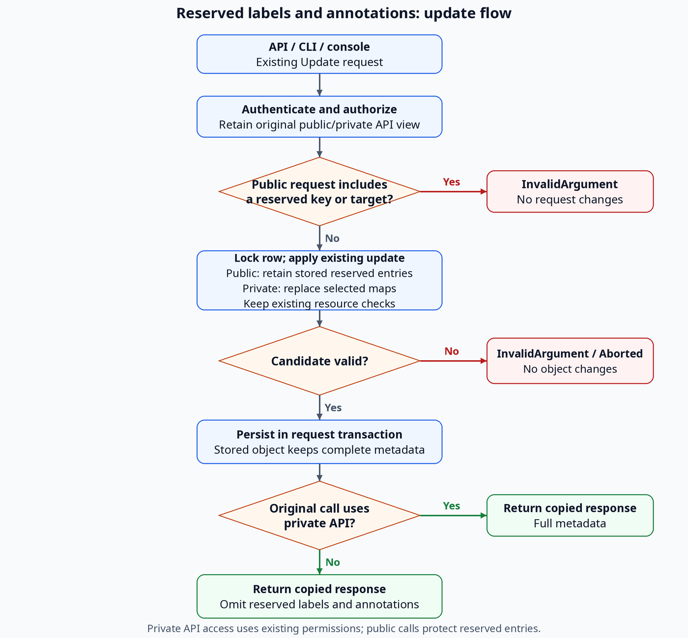

# Support Administrator-Only Labels and Annotations

## Summary

Reserve `admin.osac.openshift.io/` for administrator metadata, hide it from tenants, and protect it during existing map updates. See [PRD](prd.md) for requirements.

## Motivation

Public responses currently expose every metadata entry. Hiding reserved entries also requires preserving them when a tenant replaces the visible map.

CLI removals lose their target after local map editing, so named forbidden operations must be checked before building the request. [Codebase: fulfillment-service/internal/servers/generic_mapper.go; fulfillment-service/internal/servers/generic_server.go; fulfillment-service/internal/cmd/cli/annotate/annotate_cmd.go]

### Goals

- Reuse metadata maps, storage, Update requests, versions, and transactions.
- Apply the same protection to requests, responses, events, and filters.
- Preserve ordinary metadata behavior across API, CLI, and console.

### Non-Goals

- Public networking Update methods or changes to ordinary metadata permissions.
- Typed resource fields, configurable prefixes, or separate metadata storage.
- In-place upgrades or new provisioning workflows.

## Proposal

Both Cloud Provider Admin and Cloud Infrastructure Admin manage reserved metadata on all covered resources through the private API, CLI, and console. Tenant views omit it. [Locked: D3, D5]

Use existing whole-map updates: authorized private administrators replace selected maps; every tenant update retains the stored reserved portion. Reject supplied forbidden keys atomically, and reject named tenant CLI/console operations before sending Update. [Locked: D4, D6]

### Workflow Description

1. An administrator selects an object through private Get/List, `osac login --private`, or `/admin/metadata`.
2. The client reads its complete maps, then edits a copy while retaining untouched entries.
3. Submit the changed maps, object ID, and existing `update_mask`.
4. The server validates and saves atomically, returning the private view.



The diagram shows the server update path and response view. Named CLI/console checks run before Update.

### API Extensions

IS-1 through IS-5 identify the PRD's five In Scope bullets. These interface IDs map to [the test plan](testplan.md).

| ID | Change | Requirements |
|---|---|---|
| IC-1 | Reserve the namespace and its subdomains; keep key/value validation | IS-1, IS-2, IS-3, IS-4, IS-5 |
| IC-2 | Cover all 35 private persistent types and supported metadata updates | IS-1, IS-2, IS-4 |
| IC-3 | Preserve tenant reserved entries during existing masked or unmasked updates | IS-1, IS-3, IS-4 |
| IC-4 | Reject forbidden server input and named client operations atomically | IS-3, IS-4 |
| IC-5 | Filter object responses, nested Metadata, and events | IS-2, IS-4 |
| IC-6 | Protect filters and matching counts | IS-2, IS-4 |
| IC-7 | Carry existing administrator authority; retain tenant/client permissions | IS-1, IS-2, IS-3 |
| IC-8 | Update CLI validation, map submission, and output | IS-1, IS-2, IS-3, IS-4 |
| IC-9 | Add the console editor and protect tenant display/search | IS-1, IS-2, IS-3, IS-4 |
| IC-10 | Document prefix, operations, errors, and examples | IS-5 |

### Implementation Details/Notes/Constraints

#### Reserved keys and resource scope

Add a shared predicate for `admin.osac.openshift.io` and its subdomains. Split valid keys at `/`; the DNS prefix must equal `admin.osac.openshift.io` or end with `.admin.osac.openshift.io`. Keep case-sensitive matching and existing key/value validation, including uppercase name segments. [User: review alignment]

`admin.osac.openshift.io/tracking-id` and `child.admin.osac.openshift.io/tracking-id` are reserved, including deeper subdomains. `fakeadmin.osac.openshift.io/tracking-id`, `admin.osac.openshift.io.example/tracking-id`, `osac.openshift.io/tenant`, `osac.openshift.io/owner-reference`, `admin`, and `system` stay ordinary. Keys without a `/` have no reserved DNS prefix.

Cover all 35 persistent types:

| Area | Types |
|---|---|
| Clusters | Cluster, ClusterTemplate, ClusterCatalogItem, ClusterVersion |
| Compute | ComputeInstance, ComputeInstanceTemplate, ComputeInstanceCatalogItem, InstanceType, DiskImage |
| Bare metal | BareMetalInstance, BareMetalInstanceTemplate, BareMetalInstanceCatalogItem, BareMetalInstanceType |
| Add-ons | AddOnOperator |
| Networking | NetworkClass, VirtualNetwork, Subnet, SecurityGroup, ExternalIPPool, ExternalIP, ExternalIPAttachment, NATGateway, FabricDomain |
| Storage | StorageBackend, StorageTier, Volume |
| Administration | Hub, Tenant, User, IdentityProvider, Project, ProjectMembership, Role, RoleBinding, Secret |

Each has private Update; service enablement still applies. Hub, NetworkClass, StorageBackend, and Volume are private-only. Apply input/output protection to ephemeral SelfSubjectAccessReview without adding persistent CRUD.

#### Authorization and write validation

Carry OPA's evaluated `is_admin` boolean in AuthzDecision and Subject, defaulting to false. Preserve the original public/private method when public handlers delegate to private code. [Codebase: fulfillment-service/internal/auth/authorization_evaluator.go; fulfillment-service/internal/auth/auth_subject.go]

The public API hides reserved labels and annotations and rejects their explicit use in Create/Update for every caller, including administrators. Reserved edits require the private API. Public whole-map updates preserve stored reserved entries.

| Original API view | Reserved metadata |
|---|---|
| Private, authorized administrator | Read, create, edit, remove |
| Public, any caller, including administrators | Hidden; explicit writes denied |
| Private, non-admin | Hidden; explicit writes denied |

Add an interceptor after authorization and before dependency creation/reference processing. For public Create/Update requests and non-admin private Create/Update requests, reject every supplied reserved entry or accepted explicit reserved-key mask path with `PermissionDenied`, including unchanged values, absent targets, nested Metadata, and keys outside the mask. Apply no ordinary subset. Authorized private Create uses the existing maps and resource validation. [Locked: D4]

#### Whole-map Update

Use the existing Update request. Clients select `metadata.labels`, `metadata.annotations`, or both and send complete replacement maps.

| Selected-map input | Public caller / private non-admin | Authorized private administrator |
|---|---|---|
| Ordinary entries | Replace ordinary portion; retain stored reserved portion | Replace the map, deleting omitted entries |
| Reserved entry supplied | Reject the entire request, even outside the mask | Store the supplied entries |
| Empty or omitted map | Clear ordinary portion; retain reserved portion | Clear the map |
| Map not selected | Unchanged, subject to raw-input rejection above | Unchanged |

Empty strings are values. Existing parent-metadata, unmasked, and accepted per-key updates retain their semantics, with reserved-entry preservation on every tenant update. Identical maps and authorized absent-key removals are no-ops. [Locked: D6]

Change GenericServer's update path:

1. Read the stored object under the existing database row lock.
2. Apply the existing mask or unmasked replacement to a detached candidate.
3. For public requests and non-admin private requests, replace the candidate's reserved portion in both maps with the locked stored portion. Preserve ordinary replacement/deletion behavior.
4. Validate and save using existing identity, ownership, and resource rules. Restored stored entries are trusted data; do not reject them as caller input.

In TxInterceptor, call `tx.ReportError(&err)` before transaction End so returned handler errors roll back earlier writes. [Codebase: fulfillment-service/internal/servers/generic_server.go; fulfillment-service/internal/database/database_tx_interceptor.go]

Existing optional-lock behavior is unchanged. Reserved labels and annotations remain protected with either setting.

REST keeps `body: "object"`, generated body-derived masks, and explicit map-level query masks:

```text
PATCH /api/private/v1/compute_instances/<id>?update_mask=metadata.labels
Body: {"metadata":{"labels":{"example.org/environment":"prod"}}}
```

This replaces labels under the map rules; an empty map clears the permitted portion. Native gRPC and Connect use the existing Update request with object ID, the same map, and `update_mask.paths = ["metadata.labels"]`. No Update field or custom gateway parser is added. [Codebase: proto/gen/osac/private/v1/compute_instances_service.pb.gw.go]

#### Response, event, and query privacy

Filter detached unprivileged responses recursively through actual Metadata messages, including Get/List, Create/Update responses, nested objects, and streams. Leave unrelated maps and internal/stored objects intact. Events.Watch must project metadata before evaluating tenant predicates. [Codebase: fulfillment-service/internal/servers/events_server.go]

Inspect parsed, type-checked CEL filters. Explicit reserved-key references, membership checks, and mixed predicates return `PermissionDenied` before item/count SQL, independent of key existence. Evaluate supported whole-map predicates against JSONB with reserved entries excluded; keep ordinary literal-key indexed SQL and existing unsupported-operator errors. Authorized private administrators query full maps. [Codebase: fulfillment-service/internal/database/dao/filter_translator.go]

#### Private networking Updates

Reuse private Update for NetworkClass, VirtualNetwork, Subnet, SecurityGroup, ExternalIPPool, ExternalIP, ExternalIPAttachment, and NATGateway; all eight current paths accept map-level metadata. ExternalIP, ExternalIPAttachment, and NATGateway require a nonempty existing mask. [Codebase: fulfillment-service/internal/servers/external_ip_lifecycle.go]

Retain supported ordinary/mixed edits, specification/status/ownership validation, system-default-label restrictions, and controller status operations. Clients retain untouched operational labels. Public networking Update stays absent; the documentation conflict remains below. [Locked: D3, D5] [User]

#### CLI and console

- **CLI:** retain `label`/`annotate`, `key=value`, and `key-`. Validate all named operations before editing the fetched map; a forbidden set/removal, including an absent key in a mixed command, sends no Update and exits nonzero. Submit allowed changes as complete selected maps using existing update options. Private mode selects the API; server authorization decides access.
- **Console:** add `/admin/metadata`, a type/object selector, and shared map editor for all 35 private services. Link existing detail pages; keep private-only types in administrator navigation. Use the `admins` group claim for `isPlatformAdmin` and forward the user's token. Tenant pages use filtered maps for display/search and validate named operations. Editors retain unsaved changes after errors. [Locked: D5, D6]

Refresh UI types for the existing API inventory and update API reference, CLI help, administrator/tenant guides, and component testing maps. Document the reserved namespace, subdomain matching, and server support requirement. Reuse metadata columns/indexes, versions, and events; no API field, database migration, CRD/controller/AAP change, or Helm setting is required.

### Security Considerations

Enforce protection on the server, independently of UI roles, headers, or reflection credentials. Broad tenant visibility is not administrator authority: the restricted Container Storage Interface (CSI) identity's private Volume reads must also omit reserved entries. [Codebase: fulfillment-service/internal/auth/policies/authz.rego]

### Failure Handling and Recovery

| Failure | Outcome and recovery |
|---|---|
| Forbidden server input/query | `PermissionDenied`; no changes or key-existence disclosure. Correct input/access. |
| Named forbidden client operation | Local permission error; no Update or ordinary subset. |
| Invalid key/mask or resource edit | Existing validation error, including `InvalidArgument`; correct input. |
| Object outside scope | Existing denial/not-found behavior. |
| Database/transaction failure | Existing `Internal`/`Aborted` mapping and rollback; reload before retrying. |
| Proxy/API unavailable | Show connection failure and retain edits for retry. |

Tenant map omission succeeds for ordinary edits and preserves reserved entries. The server cannot infer a removal target discarded by the client. [Locked: D6]

### RBAC / Tenancy

Reuse existing platform-admin, method/object, tenant/project, and trusted controller permissions. Both admin personas have identical coverage; restricted clients remain non-admin. Retain tenant and owner-reference isolation annotations. No new roles or resources are added. [Locked: D5]

### Observability and Monitoring

Use existing RPC status metrics and logs; add no metrics or events. Log methods and supplied keys, never metadata values.

### Risks and Mitigations

| Risk | Mitigation |
|---|---|
| Metadata leaks or a handler drops update controls | Cover all 35 types, nested/events, and every transport. |
| Replacement loses entries | Retain untouched client entries and restore public callers' reserved entries from the locked row. |
| Client discards forbidden removal intent | Validate named operations before map editing. |
| Whole-map queries add cost | Keep literal-key indexes and inspect query plans. |
| UI authority or networking behavior diverges | Verify token/OPA mapping and existing networking validators. |

API/authentication, networking, and console maintainers review their respective boundaries.

### Drawbacks

Clients must retain untouched map entries and reload after conflicts. The console registry must track new resource types. Named-removal errors require client validation; map omission alone carries no such intent.

## Alternatives (Not Implemented)

| Alternative | Reason for rejection |
|---|---|
| Reserve all `osac.openshift.io/` | Reclassifies existing isolation/lifecycle keys. |
| Add a per-key mask | Adds request fields and forwarding across every service. |
| Qualified keys in FieldMask | Installed JSON codecs reject the paths. |
| JSON Merge Patch / JSON Patch | Adds another format/parser across transports. |
| Ignore forbidden input or reject every tenant replacement | Violates atomic denial or ordinary compatibility. |
| Frontend/admission-only filtering | Leaves direct API, events, and query/count leaks. |
| Separate maps/storage or configurable matching | Adds storage/policy work beyond the fixed namespace. |

## Open Questions

### 1. Networking metadata contract

How should the [networking design](../OSAC-1433-unified-networking/design.md#api-operation-constraint) reconcile metadata immutability with existing private updates and required administrator edits? Preserve supported ordinary operations and public immutability. [User]

- **Owner:** Fulfillment Service API and networking maintainers.
- **Impact:** IC-2, IC-3, IC-8, IC-9; TC-IS1-03 and TC-IS4-05 verify validators and lifecycle behavior.

## Test Plan

The [test plan](testplan.md) defines 28 cases covering five requirements and 10 interfaces, with commands, dependencies, and execution gaps. Implementation tests have not run.

### Unit Tests

Prefix/validation; raw-input and named-operation rejection; map selection/preservation; version/rollback; nested projection; filter privacy; administrator authority; CLI/console request and error handling.

### Integration Tests

All 35 types and both admins through deployed API, Keycloak, PostgreSQL, REST, and CLI. Include real database rollback/concurrency, Kafka events/filters, ordinary compatibility, and unchanged objects/versions/side effects after mixed forbidden requests.

### E2E Tests

Both admins edit through the deployed console/proxy/API; Tenant Admin and Tenant User receive no reserved data. Add maintained browser coverage (G-1) and complete resource/identity fixtures (G-2), including restricted CSI.

## Graduation Criteria

For 0.4 Tech Preview, resolve the networking contract, document the feature, pass required coverage, and close G-1/G-2 with maintained suites and execution evidence.

## Upgrade / Downgrade Strategy

No in-place upgrades. Check imported data for prefix collisions. Before reverting to an older server, remove reserved values from exposed state because privacy enforcement is lost; cleanup is manual.

## Version Skew Strategy

Privacy requires a server implementing this feature; older servers retain their existing metadata visibility rules. Older ordinary clients remain supported against the new server, but a discarded named removal cannot produce the new local error; reserved entries still survive. Console/proxy schemas must match the API; Update requests and CRDs gain no fields.

## Support Procedures

Inspect RPC status/logs and authorized private Get without logging values. Correct permissions/input or reload stale maps before retrying. Revoke admin membership to stop an account's reserved writes; server privacy and running workloads remain active.

## Infrastructure Needed

Reuse Kind, PostgreSQL, Keycloak, and Kafka harnesses. Add the G-1 browser runner and G-2 resource/persona fixtures; owners and closure evidence are in the test plan. No new production infrastructure is needed.

---

## Provenance

Authored: respond @ design 0.11.5 - 1c6e8de, workspace main @ f0a8211
Phases: draft, revise, revise, revise, revise, revise, revise, revise, revise, revise, respond, respond, respond, respond, respond

<!-- ai-workflow-provenance:{"schema_version":1,"provenance_kind":"session","workflow":"design","workflow_version":"0.11.5","ai_workflows":"1c6e8de","source_repo":"f0a8211","source_repo_branch":"main","commits_behind_main":0,"commits_ahead_main":0,"main_ref":"main","phases":["draft","revise","revise","revise","revise","revise","revise","revise","revise","revise","respond","respond","respond","respond","respond"],"authoring_modes":["skill"],"context_changed":false,"origin_untracked":false} -->
